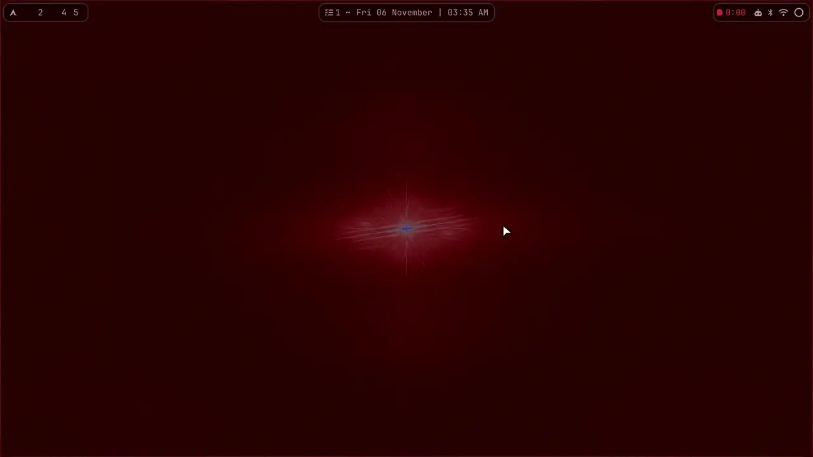

# hyprahaan

Hey. Hi. Okay, so, you found my desktop. Sorry about the mess. Actually no, it's not a mess, it's really nice, I've just been up very late with it.

This is my Arch + Hyprland setup, and it's yours now if you want it. Take all of it with one line, or poke around and steal the one thing you liked. No hard feelings either way. I'm just your friendly neighborhood dotfiles guy.

## Thirty seconds, no commitment

<a href="docs/preview.mp4"></a>

*That's the whole shell, no cuts, just sped up a touch. [Here's the sharp 1080p version](docs/preview.mp4), which you can pause when I go too fast. Which I do. People have mentioned it.*

## Okay but what is it

Everything you look at is one [Quickshell](https://quickshell.org) app, `shell/`: bar, dock, launcher, panels, notifications, all of it. Same colours, same font, same brain. The lock screen is a second little app that only shows up when you need it. That's the whole trick. I promise it's less scary than the repo size makes it look.

### The island

The clock at the top of the screen is not just a clock. I know. It got ambitious. It grows downward and turns into whatever you asked for:

- **Calendar**, `SUPER+SHIFT+C`
- **Todo**, `SUPER+SHIFT+T`, with urgent and important flags and due dates
- **Reminders**, `SUPER+SHIFT+R`. You tell it when, it drops down and swings a tiny bell at you
- **Music**, `SUPER+SHIFT+M`
- **Notifications**, `SUPER+SHIFT+N`. They drop out of the island instead of ambushing you from a corner
- **The Bhagavad Gita**, `SUPER+SHIFT+G`. A full reader, with synonyms and purports. Look, everybody needs something to read at 3 AM. Great power, great responsibility, all that

### The panels

Click the top right of the bar, and everything's right there:

- **Wi-Fi**, **Bluetooth** and **audio**, with per-device switching
- **Power**: battery health, time left, and Saver / Balanced / Perf
- **Display**: brightness, night light, scale, monitors
- **Agents**: this one's my favourite. It shows up when Claude Code or Codex is running, with usage limits for each account and tokens per model. You get to watch your weekly limit disappear in real time, which is either really useful or really sad, depending on the week

### EVE

There's an assistant living in your desktop. Her name's EVE, she's Claude in a little popup, and she's genuinely very nice.

- `SUPER+SPACE` starts a new chat, `SUPER+ALT+SPACE` picks the last one back up
- `SUPER+A` lets you just talk to her
- `SUPER+ALT+E` sends her whatever text you've selected

### Your windows, three ways

`SUPER+SHIFT+L` steps the whole desktop through **tiling**, **scrolling** and **floating**, windows already on screen included. Pick a personality. Change it at lunch.

### The launcher

`ALT+S` for apps, `ALT+F` for files, `SUPER+V` for clipboard history, `SUPER+.` for emoji. There's a calculator in there too. It's small, it's fast, it doesn't make a big thing of it.

### The settings menu

`SUPER+Return`. This is the part where you never have to open a config file again, unless you like that. No judgment. I obviously like that.

- **Theme**: 23 palettes that recolour everything live, 29 wallpapers sorted by palette, plus GTK, icons and fonts. Or pick Pywal and let your wallpaper choose the colours
- **Setup**: monitors, every keybind (remap them right there), window rules, bar, dock, notifications, EVE, default apps
- **Install / Remove**: packages, AUR and web apps, fuzzy-searched
- **Tools**: screenshots, screen recording, colour picker, OCR, voice typing
- **Security**: firewall, fingerprints, password
- **System**: power menu, power profiles, and About, which draws a spinning sigil out of your actual hardware stats. Does it need to? No. Is it staying? Yes

### And the little stuff

- **Voice typing**, `CTRL+.`, runs locally
- **Screen recording**, `SUPER+Print`, which is how the video up there happened
- **A dock** with pins, previews and a Downloads drawer
- **A lock screen** with fingerprint unlock, which also blocks new USB devices while you're away
- **An Alt+Tab switcher**, because of course
- **VMs that work** out of the box with QEMU/KVM and virt-manager

## Installing it (it's one line, I swear)

1. Install Arch with `archinstall`. Pick the **minimal** profile, give your user sudo, any network option is fine.
2. Reboot and log in on the TTY as that user.
3. Run this:

```sh
curl -fsSL https://raw.githubusercontent.com/ahaan-shah/dotfiles/main/install/bootstrap.sh | bash
```

It asks for your sudo password once, then it's on its own. Go get a sandwich. A few sandwiches, honestly: it takes **about an hour** and **around 37 GB of disk**, because AUR builds are gonna AUR build. Reboot when it's done, log in at the greeter, and hey, look at you.

Some options, if you're the careful type. I respect that. I wish I was.

```sh
curl -fsSL https://raw.githubusercontent.com/ahaan-shah/dotfiles/main/install/bootstrap.sh | bash -s -- --interactive    # ask me at every decision
curl -fsSL https://raw.githubusercontent.com/ahaan-shah/dotfiles/main/install/bootstrap.sh | bash -s -- --with-heavy     # also freesurfer-bin, 18 GiB, you know if you need it
```

Don't trust a stranger's curl pipe? Good! Great instinct, honestly. Clone it and read what it would do first:

```sh
git clone https://github.com/ahaan-shah/dotfiles.git ~/.config/dotfiles
~/.config/dotfiles/install/install.sh --dry-run    # prints every package, copy and service, changes nothing
~/.config/dotfiles/install/install.sh --list       # the phases
~/.config/dotfiles/install/install.sh --only hardware    # re-run just one
```

### A few things only you can do

I can hand you a whole desktop, but some things have to be yours:

- **EVE**: run `claude` in a terminal and log in. That's it, she'll take it from there.
- **Fingerprints**: `~/.config/dotfiles/install/install.sh --only fingerprint`, then put your finger on the thing.
- **Wi-Fi, browser logins, git identity, SSH keys**: yours, and never in this repo.

### Real talk

I ran this start to finish in VMs from a bare `archinstall`, on two different setups, and it came out clean both times. But a VM isn't your laptop. NVIDIA, fingerprint readers, real Wi-Fi and waking a real GPU from sleep haven't been through a fresh install yet. They work here on my machine, and the installer detects your hardware instead of assuming it's mine, but if something goes sideways, that's the first place I'd look. [install/README.md](install/README.md) has everything: every phase, what it won't touch, and what to do when things break.

If Hyprland ever refuses to start, don't panic. I did that part for you already. `Ctrl+Alt+F2`, then:

```sh
cat ~/.cache/hyprland/hyprlandCrashReport*.txt
lua5.4 ~/.config/dotfiles/install/lib/luastub.lua ~/.config/hypr/hyprland.lua
```

## Just here to steal one thing?

Please do, that's what it's for. `hypr/` is the Hyprland config, `shell/` is the whole Quickshell desktop, `lockscreen/` is the lock screen, `jarvis/` is EVE, and `scripts/` is all the glue holding it together. Theme palettes live in `scripts/palettes/`.

## Thank you, seriously

The palettes are derived from [omarchy](https://github.com/omacom/omarchy)'s theme set (MIT), and none of this exists without [Hyprland](https://hyprland.org), [Quickshell](https://quickshell.org) and [pywal](https://github.com/dylanaraps/pywal).

If you're more into the little-tools side of things, I also made [peach](https://github.com/ahaan-shah/peach), a TUI Splitwise, and [pear](https://github.com/ahaan-shah/pear), a TUI budget tracker. Go check 'em out. Or don't! But do.

Okay. That's it. Thanks for stopping by. Be good to your terminal.
